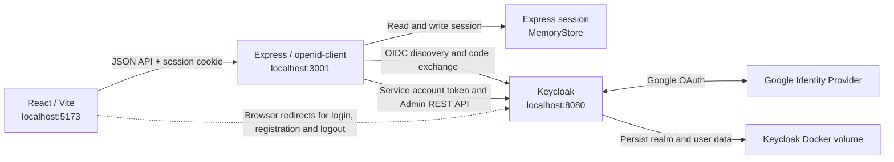
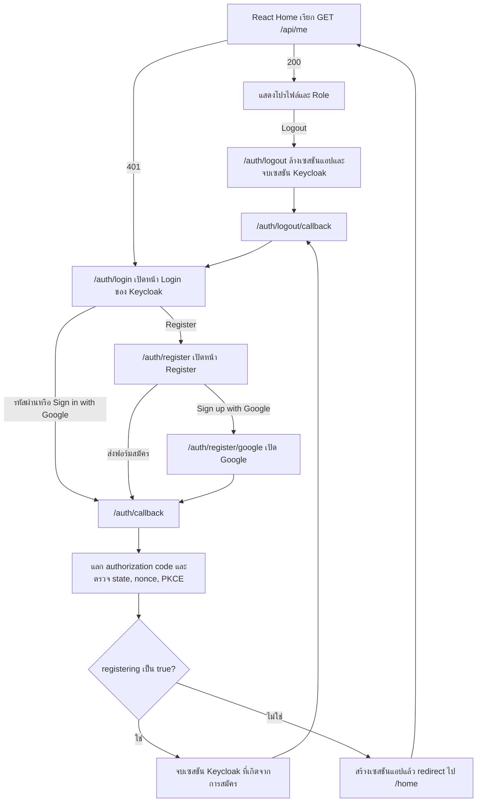

# คู่มือนักพัฒนา Keycloak Auth Project

โปรเจกต์นี้ใช้ React แสดงหน้า Home, Express ดูแลเซสชันและ API และ Keycloak จัดการการสมัคร การเข้าสู่ระบบ และบัญชีผู้ใช้ คู่มือนี้ใช้ค่าตัวอย่างของเครื่อง local ใน realm `my-company` และ Keycloak `26.8.2` ตาม Docker Compose

## Architecture



| ส่วน                                                                               | หน้าที่                                                                              |
| ---------------------------------------------------------------------------------- | ------------------------------------------------------------------------------------ |
| [backend/server.js](../backend/server.js)                                          | ตั้งค่า OIDC, ตรวจ callback, เก็บเซสชัน, ส่งข้อมูลผู้ใช้ และเรียก Keycloak Admin API |
| [Home.jsx](../frontend/src/pages/Home.jsx)                                         | แสดงโปรไฟล์และ Role, เปิดฟอร์มแก้โปรไฟล์ และเรียกดู Access Token ตามที่ผู้ใช้กด      |
| [AdminUsers.jsx](../frontend/src/pages/AdminUsers.jsx)                             | แสดงรายการผู้ใช้แบบแบ่งหน้าและฟอร์มเพิ่มหรือลบบัญชีสำหรับแอดมิน                      |
| [keycloak.js](../frontend/src/services/keycloak.js)                                | เริ่ม Login และ Logout ผ่าน backend และส่ง session cookie ไปกับ API requests         |
| [ธีม app-registration](../keycloak/themes/app-registration/login/theme.properties) | สืบทอด UI ของ `keycloak.v2` และปรับลิงก์ Register กับปุ่มสมัครด้วย Google            |
| [docker-compose.yml](../docker-compose.yml)                                        | รัน Keycloak, mount ธีม และเก็บข้อมูล Keycloak ใน named volume                       |

เบราว์เซอร์ใช้คุกกี้ `keycloak.sid` แบบ HttpOnly เพื่ออ้างถึงเซสชันใน backend เซสชันเก็บข้อมูลผู้ใช้, ID token สำหรับ Logout และ Access token สำหรับปุ่ม Debug แอปใช้ MemoryStore ตามค่าเริ่มต้นของ `express-session` การรีสตาร์ต backend จึงล้างเซสชันของแอป ส่วนข้อมูลบัญชีที่บันทึกใน Keycloak อยู่ใน Docker volume

### เส้นทาง Login, Register และ Logout



- **Role ที่แสดง** มาจาก Realm Roles และ Client Roles ที่อยู่ใน ID token หรือ Access token ระบบรวมชื่อและตัดชื่อซ้ำ ส่วน `userForResponse()` กรอง Role ระบบหกตัวก่อนส่งให้ frontend
- **สิทธิ์ Admin** มาจาก Realm Role ชื่อ `admin` ใน `realm_access.roles` ตอนล็อกอิน Backend เก็บผลเป็น `isAdmin` และใช้ `requireAdmin` ตรวจทุก API จัดการผู้ใช้ การเปลี่ยน Role มีผลต่อเซสชันใหม่เมื่อเข้าสู่ระบบอีกครั้ง
- **Service account** เป็นตัวตนที่ backend ใช้เรียก Admin REST API สิทธิ์ `realm-management/manage-users` อยู่บน service account ของ client สำหรับจัดการผู้ใช้ แอปเลือกบัญชีของเจ้าของโปรไฟล์จาก `session.user.id`
- **Debug token** ปุ่ม **Log Access Token & JWT** เรียก API เฉพาะเมื่อกด แล้วพิมพ์ Access token และ JWT payload ของเซสชันนั้นลง Console ควรปิดบัง token ก่อนแชร์ Console หรือภาพหน้าจอ

### API ที่ frontend ใช้

| Method และ path                | สิทธิ์             | ผลลัพธ์                                                                       |
| ------------------------------ | ------------------ | ----------------------------------------------------------------------------- |
| `GET /health`                  | ทุกคน              | ตรวจว่า Express พร้อมรับคำขอ                                                  |
| `GET /api/me`, `GET /api/home` | มีเซสชันแอป        | โปรไฟล์, Role ที่กรองแล้ว และ `isAdmin`                                       |
| `GET /api/me/access-token`     | มีเซสชันแอป        | Access token ของตัวเองและ decoded JWT payload พร้อม `Cache-Control: no-store` |
| `PUT /api/me/profile`          | มีเซสชันแอป        | บันทึก Username, First name และ Last name ของผู้ใช้ปัจจุบันลง Keycloak        |
| `GET /api/admin/users?first=0` | Realm Role `admin` | รายการผู้ใช้หน้าละ 20 รายการ                                                  |
| `POST /api/admin/users`        | Realm Role `admin` | สร้างบัญชีด้วยรหัสผ่านชั่วคราวที่ต้องเปลี่ยนเมื่อเข้าสู่ระบบ                  |
| `DELETE /api/admin/users/:id`  | Realm Role `admin` | ลบบัญชีที่เลือก โดย backend ปฏิเสธการลบบัญชีของผู้เรียกเอง                    |

## เริ่มระบบ local

ใช้ Docker Compose และ Node.js รุ่นที่ Vite รองรับ เช่น Node.js 24 จาก root ของ repo ให้รัน Keycloak ก่อน

```sh
docker compose up -d keycloak
```

เปิด Keycloak Admin Console ที่ `http://localhost:8080/admin/` แล้วเลือก realm `my-company` หากเป็น Docker volume ใหม่ ให้สร้าง realm และ client ตามหัวข้อถัดไป ตั้งค่า `backend/.env` ด้วยค่า secret จากเครื่องของตัวเอง

```dotenv
KEYCLOAK_ISSUER=http://localhost:8080/realms/my-company
KEYCLOAK_CLIENT_ID=web-app
KEYCLOAK_CLIENT_SECRET=<login-client-secret>
SESSION_SECRET=<random-session-secret>
BACKEND_URL=http://localhost:3001
FRONTEND_URL=http://localhost:5173
KEYCLOAK_PROFILE_CLIENT_ID=profile-service
KEYCLOAK_PROFILE_CLIENT_SECRET=<profile-client-secret>
```

สองค่า `KEYCLOAK_PROFILE_CLIENT_*` จำเป็นเมื่อใช้การบันทึกโปรไฟล์และจัดการบัญชี เก็บ secret ใน `backend/.env` ซึ่ง Git ignore อยู่แล้ว รัน backend และ frontend คนละ terminal โดยเริ่มจาก root ของ repo ในแต่ละหน้าต่าง

```sh
cd backend
npm ci
npm run dev
```

```sh
cd frontend
npm ci
npm run dev
```

เปิด `http://localhost:5173` สำหรับหน้าแอป และใช้ `http://localhost:3001/health` ตรวจ backend ถ้าเปลี่ยน host หรือ port ให้ปรับค่าใน `.env` และ URL ฝั่ง frontend ใน [keycloak.js](../frontend/src/services/keycloak.js) ให้ตรงกัน ตั้ง `APP_REGISTRATION_URL` ให้ชี้ไปที่ `<BACKEND_URL>/auth/register` หากใช้ backend คนละ URL กับค่าเริ่มต้นของ Compose

## เพิ่ม Client ใหม่ใน Keycloak

### Client สำหรับ Login และ Register

1. เลือก realm ของแอป แล้วเข้า **Clients → Create client** เลือก **OpenID Connect** ตั้ง Client ID เช่น `web-app`
2. เปิด **Client authentication** และ **Standard flow** แล้วบันทึก แอปใช้ authorization code flow และส่ง PKCE แบบ `S256`
3. ใน **Settings** เพิ่ม **Valid redirect URIs** เป็น `http://localhost:3001/auth/callback` และ **Valid post logout redirect URIs** เป็น `http://localhost:3001/auth/logout/callback` ใช้ URL จริงของ backend ในแต่ละ environment
4. ตรวจว่า client ใช้ scopes `profile` และ `email` สำหรับข้อมูลโปรไฟล์ ใน **Login settings → Login theme** เลือก `app-registration`
5. หากต้องการสมัครด้วยฟอร์ม เปิด **Realm settings → Login → User registration** จากนั้นคัดลอก Client ID กับ Secret จาก **Credentials** ลง `KEYCLOAK_CLIENT_ID` และ `KEYCLOAK_CLIENT_SECRET` แล้วรีสตาร์ต backend

Backend อ่าน client สำหรับ Login ได้หนึ่งตัวต่อ process จาก environment ถ้าสร้าง client สำหรับอีกแอป ให้แอปนั้นใช้ config ของตัวเอง [คู่มือ OIDC clients ของ Keycloak](https://www.keycloak.org/docs/latest/server_admin/index.html#_oidc_clients)

### Client สำหรับบันทึกโปรไฟล์และจัดการบัญชี

1. สร้าง OpenID Connect client อีกตัว เช่น `profile-service` ใน realm เดียวกัน เปิด **Client authentication** และ **Service accounts roles** ปิด **Standard flow** สำหรับ client ที่ใช้เฉพาะ backend
2. เข้า **Service account roles → Assign role → Filter by clients** แล้วเลือก `manage-users` จาก `realm-management` หากคอลัมน์ **Inherited** แสดง `false` หมายถึง role ถูก assign โดยตรง
3. ใน **Client scopes → dedicated scope → Scope** ตรวจว่า role scope mappings อนุญาต `realm-management/manage-users` โดยเฉพาะเมื่อ **Full Scope Allowed** ปิดอยู่
4. เข้า **Client scopes → Add client scope** แล้วเพิ่ม `kc-admin-api` เป็น **Default** โค้ดเรียก client credentials grant โดยอาศัย default scopes ที่ผูกกับ client
5. คัดลอก Client ID กับ Secret ไปที่ `KEYCLOAK_PROFILE_CLIENT_ID` และ `KEYCLOAK_PROFILE_CLIENT_SECRET` แล้วรีสตาร์ต backend

สำหรับปุ่มจัดการบัญชีบนหน้า Home ให้สร้าง Realm Role `admin` ใน **Realm roles** แล้ว assign ให้บัญชีทดสอบผ่าน **Users → Role mapping** ส่วน `manage-users` ให้กับ service account ตามขั้นตอนข้างบน [คู่มือ Service accounts](https://www.keycloak.org/docs/latest/server_admin/#_service_accounts) · [ข้อกำหนด Admin API ของ Keycloak 26.8.2](https://www.keycloak.org/docs/26.8.2/upgrading/#admin-rest-api-now-enforces-an-audience-check)

### เปิด Google Login และ Register

1. ใน Google Auth Platform สร้าง OAuth client ประเภท **Web application** แล้วตั้ง Authorized redirect URI ให้ตรงกับช่อง Redirect URI ที่ Keycloak แสดง สำหรับ local และ alias `google` คือ `http://localhost:8080/realms/my-company/broker/google/endpoint`
2. ใน realm ของแอปไปที่ **Identity providers → Add provider → Google** ใช้ alias `google` แล้วใส่ Google Client ID และ Secret
3. ตรวจว่า Google provider เปิดใช้งาน และแสดงบนหน้า Login หาก Google OAuth app อยู่ในโหมด **Testing** ให้ตั้งค่าบัญชีทดสอบตามการตั้งค่า Audience ของโปรเจกต์ Google
4. ทดสอบแยกทั้ง **Sign in with Google** จากหน้า Login และ **Sign up with Google** จากหน้า Register ตัวแรกเข้า Home หลังสำเร็จ ตัวหลังกลับหน้า Login

[คู่มือ Google OAuth](https://developers.google.com/identity/protocols/oauth2/web-server#creatingcred) · [คู่มือ Google Identity Provider ของ Keycloak](https://www.keycloak.org/docs/latest/server_admin/#_google)

## Troubleshooting

เริ่มจากดู **DevTools → Network** ว่า request ไหนล้มเหลวและตอบ status อะไร แล้วเทียบกับ log ของ backend และ Keycloak

```sh
docker compose ps
docker compose logs --tail=100 keycloak
curl -fsS http://localhost:3001/health
curl -fsS http://localhost:8080/realms/my-company/.well-known/openid-configuration
```

| อาการ                                                        | สิ่งที่ควรตรวจ                                                                                                                                                                                                    |
| ------------------------------------------------------------ | ----------------------------------------------------------------------------------------------------------------------------------------------------------------------------------------------------------------- |
| Backend เปิดแล้วหยุดที่ discovery                            | ตรวจว่า container พร้อมรับคำขอและ `KEYCLOAK_ISSUER` ตรง realm ต้องเปิด discovery URL ได้ก่อน backend จะเริ่ม listen                                                                                               |
| Keycloak ขึ้น `invalid_redirect_uri`                         | เปรียบเทียบ URL ในคำขอกับ **Valid redirect URIs** หรือ **Valid post logout redirect URIs** ของ login client ให้พอร์ตและ path ตรงกัน                                                                               |
| หน้า Home วนกลับ Login หรือ `/api/me` ตอบ `401` หลังล็อกอิน  | ตรวจว่าเบราว์เซอร์ได้รับและส่ง `keycloak.sid`, ใช้ hostname เดียวกันใน local, เปิด React จาก origin ที่ตรงกับ `FRONTEND_URL` และใช้ HTTPS เมื่อเปิด production secure cookie                                      |
| Callback กลับหน้า Home หรือขึ้นข้อผิดพลาดหลังเปิดหลายแท็บ    | ถ้าข้อมูล OIDC ในเซสชันหาย โค้ดจะ redirect ไป Home เพื่อเริ่มใหม่ ถ้าแท็บอื่นเริ่ม Login หรือ Register ใหม่ ค่า PKCE, state และ nonce รอบก่อนอาจถูกเขียนทับ ลองเริ่ม flow ใหม่ในแท็บเดียว                         |
| สมัครเสร็จแล้วเข้า Home ทันที                                | ตรวจ **Login theme** ของ login client และเอาเมาส์ชี้ **Register** บนหน้า Keycloak ลิงก์ควรชี้ไป `/auth/register` ของ backend ถ้าธีมไม่ขึ้นในรายการให้รัน `docker compose up -d keycloak` แล้วรีเฟรช Admin Console |
| Back to Login แล้วล็อกอินสำเร็จแต่กลับหน้า Login อีกครั้ง    | ลิงก์ Back to Login บนธีมยังใช้ปลายทางเดิมของ Keycloak หากกลับมาในรอบสมัครเดิม backend อาจยังอ่าน `registering=true` เปิดแอปใหม่เพื่อเริ่มรอบ `/auth/login` แล้วทดสอบซ้ำ                                          |
| ปุ่ม Google ไม่ขึ้น หรือ Google ขึ้น `redirect_uri_mismatch` | ตรวจ alias `google`, สถานะ provider, ธีม `app-registration` และ Authorized redirect URI ใน Google ให้ตรงกับที่ Keycloak แสดง                                                                                      |
| แก้โปรไฟล์หรือโหลดรายการผู้ใช้แล้วได้ `503`                  | ตรวจ `KEYCLOAK_PROFILE_CLIENT_ID` และ `KEYCLOAK_PROFILE_CLIENT_SECRET` ว่าตั้งทั้งคู่ใน `backend/.env` และรีสตาร์ต backend หลังแก้                                                                                |
| แก้โปรไฟล์หรือจัดการผู้ใช้แล้วได้ `502`                      | Backend ได้การปฏิเสธจาก Admin API ให้ตรวจ `kc-admin-api` เป็น Default scope ของ profile client หาก upstream ตอบ `401` และตรวจ `manage-users` ใน role ของ service account กับ scope mapping หาก upstream ตอบ `403` |
| ผู้ใช้มองไม่เห็นส่วน Users หรือ API ตอบ `403`                | ตรวจว่า account ของคนที่ล็อกอินได้ **Realm Role `admin`** จาก realm ของแอป แล้วออกและเข้าสู่ระบบใหม่ ตรวจ `isAdmin` ใน response ของ `/api/me`                                                                     |
| Role ไม่ขึ้น หรือชื่อ Role หายบางตัว                         | ตรวจว่า Role อยู่ใน token ของ login client และดูรายการที่ `userForResponse()` กรองออก ถ้าเพิ่ง assign ให้ล็อกอินใหม่                                                                                              |
| บันทึกชื่อหรือสร้างผู้ใช้แล้วได้ `400` หรือ `409`            | `400` ให้ตรวจเงื่อนไขฟอร์ม กฎ User Profile และ Password Policy ใน realm ส่วน `409` ให้ตรวจชื่อผู้ใช้หรืออีเมลที่ซ้ำตาม operation                                                                                  |
| ปุ่ม Log Access Token ตอบ `409`                              | เซสชันเดิมอาจไม่มี token หรือ Access token หมดอายุ ให้ออกจากระบบแล้วเข้าระบบใหม่                                                                                                                                  |

### ตรวจหลังแก้โค้ดหรือตั้งค่า

```sh
node --check backend/server.js
npm --prefix frontend run lint
npm --prefix frontend run build
docker compose config --quiet
```

1. ใช้หน้าต่างไม่ระบุตัวตนทดสอบเปิดแอป ล็อกอิน และ Logout ตรวจว่ากลับไปหน้า Login ของ Keycloak
2. สมัครบัญชีทดสอบผ่านฟอร์มและ Google แล้วตรวจว่ากลับหน้า Login ก่อนเข้าสู่ระบบเอง
3. ล็อกอินด้วยบัญชีทั่วไป แก้โปรไฟล์ แล้วออกและเข้าใหม่เพื่อตรวจว่าค่าคงอยู่ ตรวจว่า API จัดการผู้ใช้ตอบ `403` สำหรับบัญชีนี้
4. ล็อกอินด้วยบัญชีที่มี Realm Role `admin` ตรวจรายการ เพิ่มบัญชีทดสอบ และลบบัญชีทดสอบที่เพิ่งสร้าง
5. กด **Log Access Token & JWT** แล้วตรวจ Console ว่ามี token และ decoded payload ของบัญชีที่ล็อกอิน
